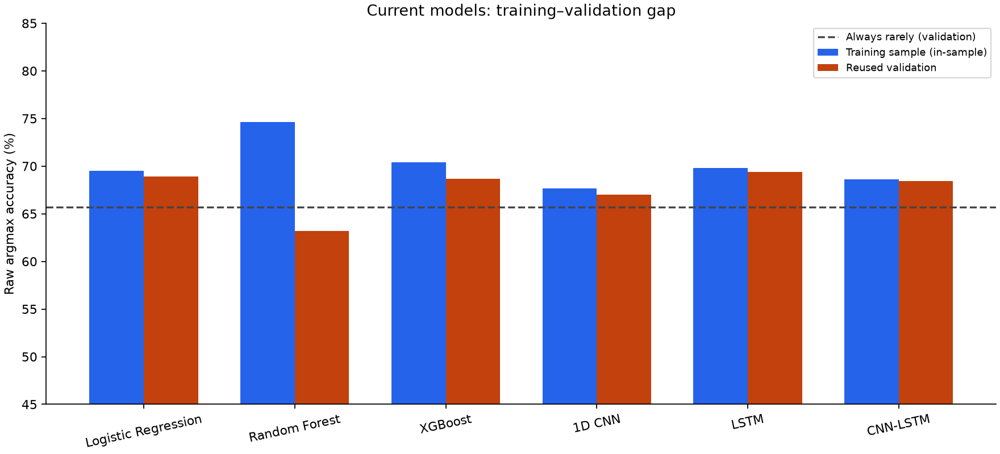
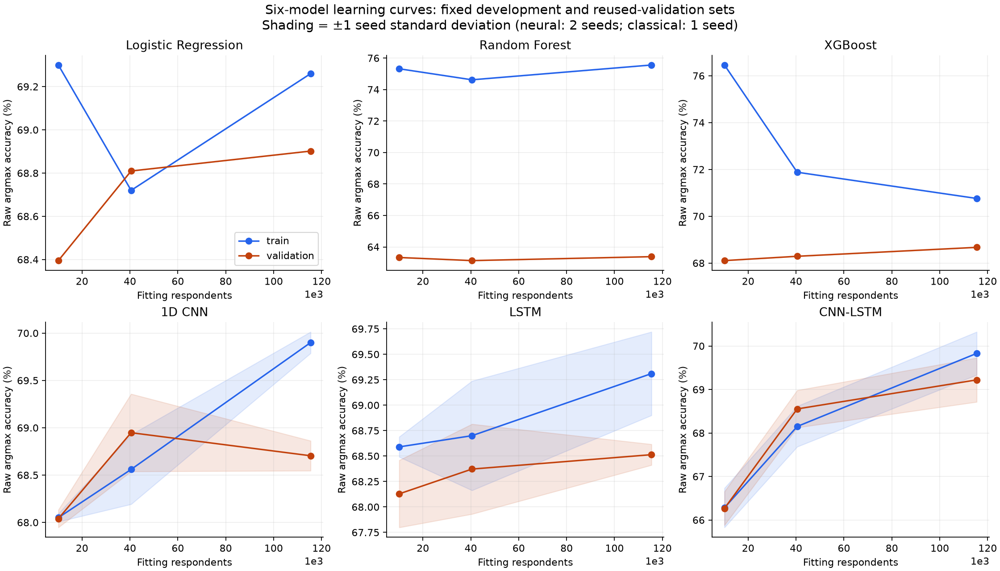
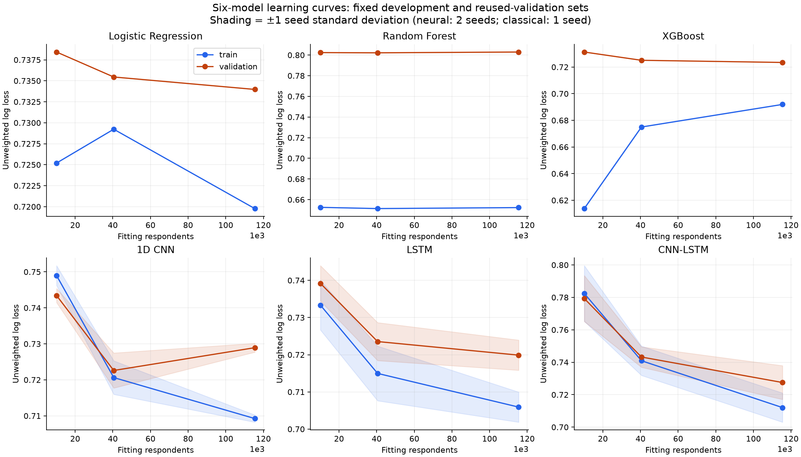

# Six-model evidence diagnosis — Phase 1

Phase 1 is complete. This report reproduces the current models, measures learning curves and training gaps, and audits ambiguous records. It does not claim that all six models improved or that an untouched test set exists. No production model, respondent or label was changed.

## Corrected project facts

The task is three-class classification of self-reported stress frequency: rarely/never, sometimes, usually/always. There are 183,040 real BRFSS 2022 respondents, including 128,248 training, 15,197 validation, 30,718 test and 8,877 quarantined records. The earlier 10,000-row subset was real sampled data, not synthetic.

The six model families are Logistic Regression, Random Forest, XGBoost, 1D CNN, LSTM and CNN-LSTM. The 19 core predictors are age, sleep duration, physical unhealthy days, BMI, sex, exercise, general health, marital status, education, employment, income, support, isolation, job loss, food insecurity, bill difficulty, utility threat, transport barrier and medical cost. Four are numeric; the remaining15 are categorical/ordered scales. The current encoder produces69 inputs.

These are cross-sectional survey features, not a time series. The recurrent models process feature positions; they do not observe temporal history. Existing source comments describing temporal/physiological learning are misleading for this dataset.

The existing test set has informed earlier decisions. It was not opened for this diagnosis. Any future evaluation there must be described as a reused internal holdout. A fresh random split cannot erase prior model-selection exposure.

## Reproduced baseline on reused validation

| Model | Current-rule accuracy | High recall | Sometimes recall | Macro-F1 | QWK | Macro AUC |
|---|---:|---:|---:|---:|---:|---:|
| Logistic Regression | 67.63% | 64.47% | 18.80% | 0.5226 | 0.4943 | 0.7790 |
| Random Forest | 66.46% | 62.00% | 25.72% | 0.5337 | 0.4954 | 0.7665 |
| XGBoost | 67.45% | 65.04% | 21.41% | 0.5307 | 0.5063 | 0.7839 |
| 1D CNN | 68.91% | 52.05% | 15.39% | 0.5116 | 0.4748 | 0.7693 |
| LSTM | 69.04% | 57.05% | 21.41% | 0.5374 | 0.5081 | 0.7835 |
| CNN-LSTM | 67.82% | 60.60% | 18.36% | 0.5208 | 0.4998 | 0.7722 |
| Always rarely | 65.68% | 0% | 0% | — | — | — |

All six checkpoints were reloaded and predictions matched saved validation probabilities within1e-6. Accuracy uses the current decision rules; AUC uses raw scores. Per-class precision/recall/F1 and confusion matrices are saved in baseline.json. The historical holdout majority baseline is65.78%; use the partition-specific baseline above for this table.

Current minority recall is uneven. In particular, CNN/LSTM accuracy should not be presented as evidence that they meet a60% high-recall requirement. Comparing candidate accuracy without matching detection constraints would be misleading.

## Training versus validation

| Model | Training-sample raw accuracy | Validation raw accuracy | Gap (points) |
|---|---:|---:|---:|
| Logistic Regression | 69.52% | 68.89% | +0.63 |
| Random Forest | 74.66% | 63.20% | +11.46 |
| XGBoost | 70.42% | 68.67% | +1.75 |
| 1D CNN | 67.68% | 66.99% | +0.69 |
| LSTM | 69.80% | 69.41% | +0.39 |
| CNN-LSTM | 68.60% | 68.45% | +0.15 |

Training values use a deterministic5,000-row in-sample diagnostic sample, not a fresh test. Random Forest has the largest observed gap. Smaller gaps in other models can reflect weak features, regularization, optimization limits or genuine overlap; they do not prove an irreducible ceiling.

## Learning curves

All curves use the same fixed grouped development split and reused validation set. Training sizes are nested group-hash subsets. Classical models use one seed; neural models use two. Neural epochs are selected by development log loss, never validation accuracy. Training is capped at14epochs or120seconds checked between epochs, with patience4. Time-limited or still-improving runs cannot establish convergence.

| Model | Small validation accuracy | Medium validation accuracy | Full validation accuracy | Full seed SD (points) | Time-limited runs |
|---|---:|---:|---:|---:|---:|
| Logistic Regression | 68.40% (10,115 rows) | 68.81% (40,494 rows) | 68.90% (115,423 rows) | n/a | 0 |
| Random Forest | 63.33% (10,115 rows) | 63.13% (40,494 rows) | 63.38% (115,423 rows) | n/a | 0 |
| XGBoost | 68.11% (10,115 rows) | 68.29% (40,494 rows) | 68.67% (115,423 rows) | n/a | 0 |
| 1D CNN | 68.04% (10,115 rows) | 68.95% (40,494 rows) | 68.70% (115,423 rows) | 0.16 | 0 |
| LSTM | 68.13% (10,115 rows) | 68.37% (40,494 rows) | 68.51% (115,423 rows) | 0.10 | 0 |
| CNN-LSTM | 66.27% (10,115 rows) | 68.55% (40,494 rows) | 69.22% (115,423 rows) | 0.51 | 0 |

These are raw argmax curves, not promoted recall-constrained operating points. Classical one-seed results do not have an estimated seed standard deviation. Two neural seeds provide only a limited variability check, not a confidence interval or5x2 repeated CV.

## Data quality, conflicts and label review

All 183,040 respondent IDs are unique and profile groups do not cross the existing splits. The modeling table has no missing predictor values and passes current schema limits and target mappings. It was built using complete-case exclusions; this does not establish that missingness in the source survey is random.

Within training there are 86 repeated19-feature rows belonging to distinct respondents, and 17 exact feature groups with conflicting labels (34 respondents). Exact conflicts force at least 17 mismatches for a deterministic lookup on these observed rows. That tiny count cannot explain a31% error rate. The corresponding in-sample lookup maximum is not a generalization ceiling.

A coarse near-match proxy finds 2875 multi-person groups and 753 conflicting groups. It rounds age to5-year bins, BMI to1unit and physical days to5-day bins while keeping other features fixed. Bin membership does not prove duplicate people or erroneous labels. No such rows were removed.

Cleanlab flagged 31,359 records (24.45%) from raw weighted group-OOF probabilities and 24,431 (19.05%) after an approximate reversal of training class weights. The latter is a sensitivity check, not probability calibration. This disagreement shows that flags depend on model assumptions. Neither percentage is a verified label-error rate or an accuracy ceiling.

Cleanlab was run on predictions made out of fold, as recommended in its [official documentation](https://docs.cleanlab.ai/stable/cleanlab/filter.html). No test rows were used. The model’s limited predictive power, class weighting and unmeasured circumstances can all create false label-error flags.

Reviewed 35 unique flagged examples against the original fixed-width source. Every recorded stress response and target mapping matched. Highly flagged examples include older respondents reporting high stress despite otherwise favorable measured predictors; these combinations are possible. No verified source-level label error was found, so no label or row was changed.

## Feature drift and outlier diagnostics

A separate feature-only domain classifier achieved out-of-fold AUC 0.5003 distinguishing training from validation. Its three fold AUCs were 0.4971, 0.5017, 0.5035. This detects no substantial shift under this classifier; it does not prove absence of all distribution change. Stress labels and the test set were not used.

| Numeric feature | Training min/max | IQR flags (training) | Train-fitted 1st/99th percentiles |
|---|---|---:|---|
| age | 18.00 / 80.00 | 0 | 19.00 / 80.00 |
| sleep_duration | 1.00 / 24.00 | 1,735 | 3.00 / 11.00 |
| unhealthy_days | 0.00 / 30.00 | 21,043 | 0.00 / 30.00 |
| bmi | 12.16 / 97.65 | 4,049 | 18.08 / 49.60 |

IQR flags are not errors. For example, physical unhealthy days up to30 are valid survey responses; an IQR rule flags many meaningful severe cases. No clipping, imputation or deletion was performed. Source invalid/missing counts overlap and include modules not asked; they cannot be interpreted as independent random missingness.

## What this establishes—and what it does not

- Random Forest deserves a targeted variance/regularization check; the strongest measured overfitting signal is model-specific.
- Exact duplicate/conflicting profiles are too rare to explain present performance. They do not justify deleting difficult respondents.
- Missing-value imputation comparisons cannot change an already complete table. Recovering incomplete real source respondents would require a separate missingness/selection-bias protocol.
- Smaller training sets are not a demonstrated route to80% accuracy. Learning curves should guide any expansion, with convergence and seed limits respected.
- No defensible numerical maximum accuracy or verified mislabeled percentage has been established. Approximately69% is observed performance, not a proved ceiling.

## Next phases and evidence requirements

Phase2 should test only justified data treatments: retain all source-confirmed labels, compare train-fitted outlier handling against keep, and quantify train/validation feature drift. Phase3 should rank features on training-only held-out folds before selecting interactions. Phase4 should focus model-specific changes, using repeated grouped CV for finalists and multiple neural seeds. Existing feature/XGBoost/ensemble experiments must remain explicit baselines rather than being presented as new trials.

Phases2–6 are not reported as completed by this Phase1 diagnosis. No new candidate has been selected for final testing. The requested final comparison on an untouched test set cannot be supplied from the already reused test data; suitable fresh data would be required.

## Reproducible evidence

protocol.json and frozen_hashes.json record the fixed design. baseline.json contains full current metrics. curve_*.json and learning_curves.json contain all27 fits, seeds, actual training counts, epoch histories, wall time and process peak memory. learning_curve_roles.csv contains exact memberships. Ambiguity samples, Cleanlab settings and source_label_review.json document the review. verification.json confirms original-file integrity and split checks.

All active models, source data and past results remain unchanged. No deployment was performed.
